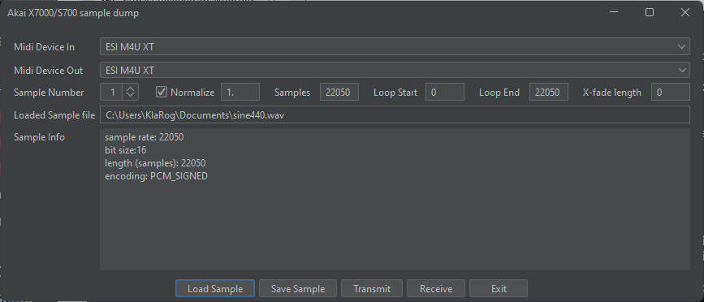

# Akai X7000/S700 sample dump
Program to transfer samples via midi sample dump to/from Akai X7000 and S700 samplers. 
Although seemingly based on the SDS standard, Akai did not follow it exactly so the samplers 
needs to use a specific implementation using their protocol to work.

**Note:** this is currently in experimental state to see what can be done, most importantly, currently I haven't got recieving sample dump from the sampler to the computer working yet.

## What's currently working
* Transmitting sample file to the sampler, optionally with loop start/end

The program can initiate a sample dump from the sampler and receive the information about the sample 
but it then seem's to quit after that. So that need further investigations.
Only tested on my X7000 with version 1.6 firmware.

**NB:** The samplers does not support standard sample rates like 44100 or 22050, but it will accept them, 
setting the internal samplerate to the nearest samplerate of it's supported ones and seemingly trying to adjust the program tune so the sample should play in tune.  
However it does it incorrectly, correcting it in the opposite direction.  
So if sending a sample with sample rate 44100, it will set it to using a samplerate of 
39555.4 hz, and set the program tune to -88, but it should be +88 to give the correct pitch on playback.  
It should be possible to send the program tune parameter with sysex, so it could be corrected.  
It would be possible to resample the audio data to the nearest supported samplerate as well, but that will be more work :-)

## Building
The program is programmed in Java, minimum version Java 21.
You can start the build by running the gradle wrapper command.
Make sure that you path to the Java SDK is set up

    C:\Develop\Axs7Sds>set JAVA_HOME="C:\Develop\Java\jdk-21.0.3+9-windows-x64"
    C:\Develop\Axs7Sds>gradlew shadowJar

You will get a runnable jar file in build\libs\Axs7Sds-all.jar

## Running 
    C:\Develop\Axs7Sds>java -jar build\libs\Axs7Sds-all.jar

**Midi Device In:** Midi input port  
  
**Midi Device Out:Midi** output port  
  
*Since the protecol requires the sending of acknowledge packets, you will need to have a 2 way communication even if just sending data to the sampler (or just receiving)*  
  
**Sample Number:** Sample number to transmit or receive (1-6)  
  
**Normalize:** If checked normalize the audio to make sure all 12 bits are used (value = 1.)  
  
**Samples:** number of samples in file or received data, max 32752, if file is longer it will be truncated  
  
**Loop Start:** loop start
  
**Loop End:** loop end  
  
**X-fade length:** (experimental) if > 0 this will calculate a crossfade for the loop. This will be done on the wave data before sent by fading out the sample from loopend-xfadelength and fading in data from loopstart-xfadelength, so that means loop-start must be the same or later than the xfade-length
  
**Load Sample:** read audio file to send to sampler  
  
**Save Sample:** save audio file received from sampler (or if you have read it from disk previous, it will write that, including truncation the length and doing the xfade calculation if set)  
  
**Transmit:** send audio in memory to sampler  
  
**Receive:** receive sample from the sampler  
  
**Exit:** exit the program

